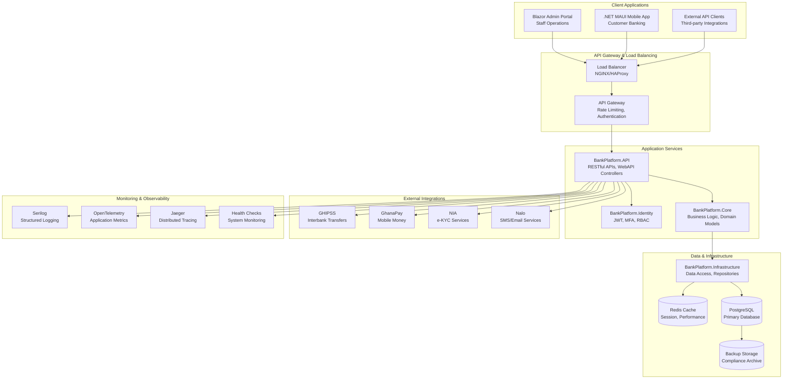
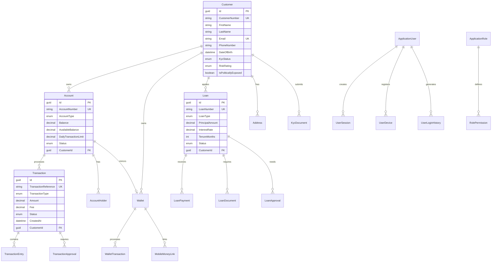
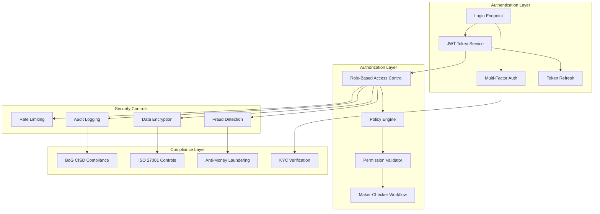
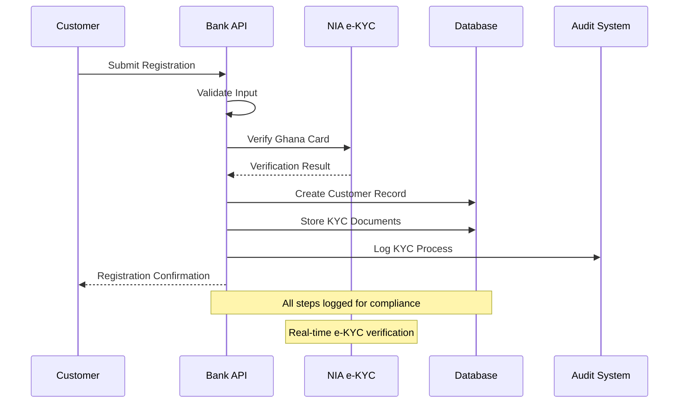
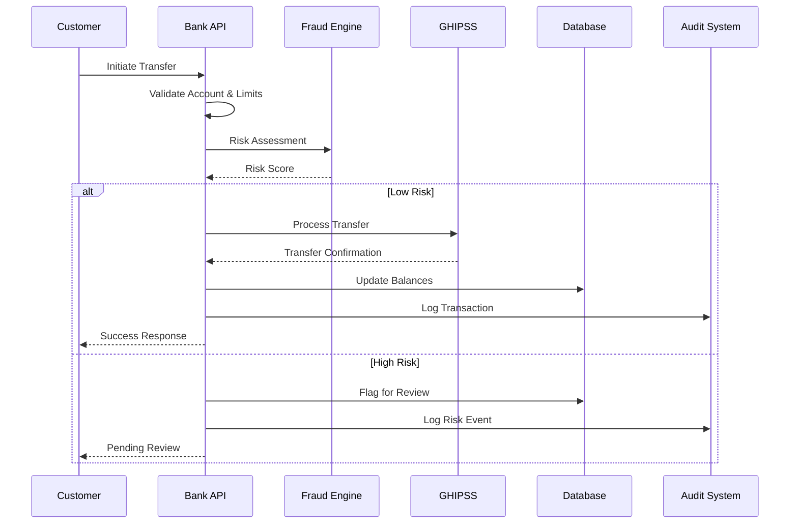
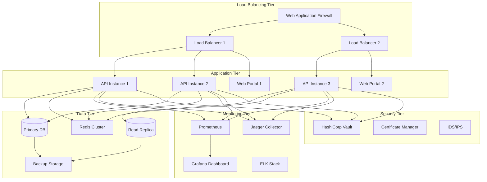
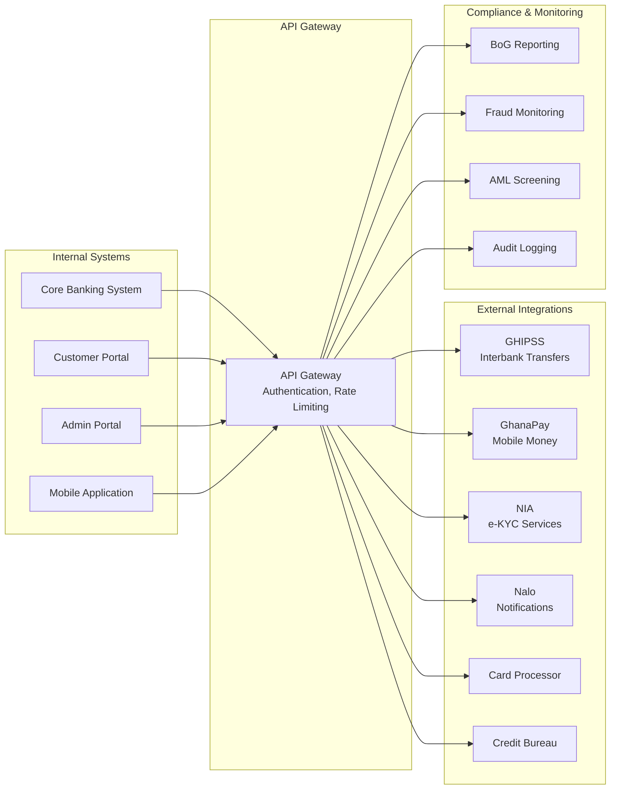
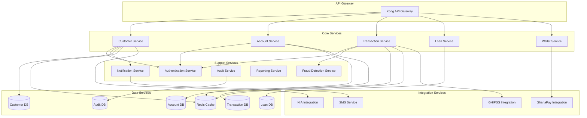

# BoG-Compliant Digital Banking Platform - Architecture Documentation

## System Architecture Overview

The BoG-Compliant Digital Banking Platform follows a clean, layered architecture designed for scalability, maintainability, and regulatory compliance.

### High-Level Architecture

## Domain Model Architecture

## Security Architecture

## Data Flow Architecture

### Customer Onboarding Flow

### Transaction Processing Flow

## Deployment Architecture

### Production Environment

## Integration Architecture

## Microservices Architecture (Future State)

## Technology Stack

### Backend Technologies
- **.NET 9**: Latest .NET framework for high performance
- **ASP.NET Core**: Web API framework
- **Entity Framework Core**: Object-relational mapping
- **PostgreSQL/MySQL**: Primary database systems
- **Redis**: Caching and session storage
- **Serilog**: Structured logging framework
- **OpenTelemetry**: Observability framework
- **Polly**: Resilience and transient-fault handling

### Security Technologies
- **JWT**: JSON Web Tokens for authentication
- **ASP.NET Core Identity**: User management framework
- **BCrypt**: Password hashing
- **AES-256**: Data encryption
- **TLS 1.3**: Transport layer security

### Integration Technologies
- **HTTP Client**: REST API consumption
- **SignalR**: Real-time communication
- **Hangfire**: Background job processing
- **MassTransit**: Message bus (future)

### DevOps Technologies
- **Docker**: Containerization
- **GitHub Actions**: CI/CD pipeline
- **NGINX**: Reverse proxy and load balancer
- **Jaeger**: Distributed tracing
- **Prometheus**: Metrics collection
- **Grafana**: Monitoring dashboards

### Compliance Technologies
- **Audit Logging**: Full activity tracking
- **Data Encryption**: At-rest and in-transit
- **Rate Limiting**: API protection
- **Health Checks**: System monitoring
- **Backup Systems**: Data protection

## Performance Characteristics

### Response Time Targets
- Authentication: < 200ms
- Account queries: < 100ms
- Transaction processing: < 500ms
- Report generation: < 2s

### Scalability Targets
- Concurrent users: 10,000+
- Transactions per second: 1,000+
- Database size: 100GB+
- Log retention: 7 years

### Availability Targets
- System availability: 99.9%
- Planned maintenance: < 4 hours/month
- Recovery time objective: < 1 hour
- Recovery point objective: < 15 minutes

## Security Considerations

### Data Protection
- Encryption at rest (AES-256)
- Encryption in transit (TLS 1.3)
- Key management with HSM
- Data masking in non-production
- GDPR compliance features

### Access Control
- Multi-factor authentication
- Role-based access control
- Principle of least privilege
- Session management
- IP whitelisting capabilities

### Monitoring & Auditing
- Comprehensive audit logging
- Real-time fraud detection
- Security information and event management (SIEM)
- Penetration testing
- Vulnerability assessments

## Compliance Framework

### Bank of Ghana (BoG) CISD
- Customer identification requirements
- Transaction monitoring and reporting
- Data retention policies
- Risk management procedures
- Incident response protocols

### ISO 27001
- Information security management system
- Risk assessment and treatment
- Security controls implementation
- Continuous monitoring
- Management review processes

### Additional Standards
- PCI DSS (future card operations)
- GDPR data protection
- AML/CFT regulations
- Basel III capital requirements (future)